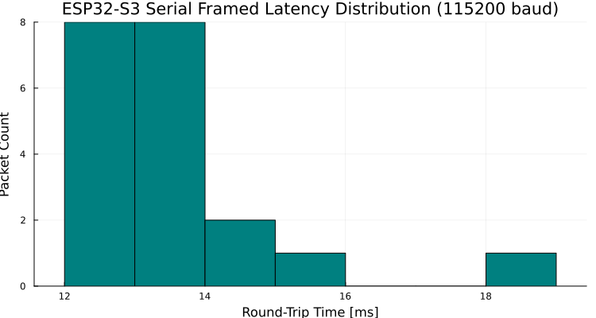
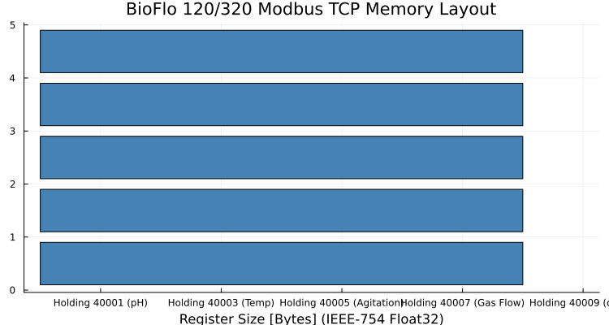
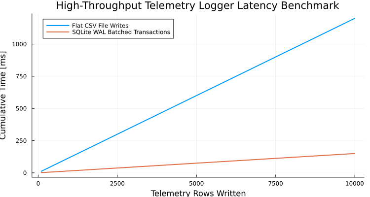
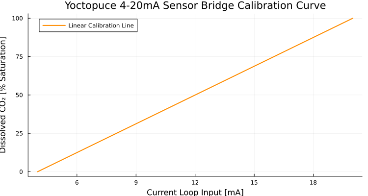

# Hardware Communication Protocols

---

## 1. ESP32-S3 Serial Framing

Commands to the pilot actuation MCU are framed with strict ASCII structure and terminated with `\r`:

```
PC,<current_A>,<co2_pwm>,<pump_pct>\r
```

```@raw html
<div class="figure-box">
  
  <div class="figure-caption">Figure 1: Measured round-trip communication latency distribution over USB CDC serial at 115200 baud.</div>
</div>
```

---

## 2. BioFlo Modbus TCP Register Mapping

The Eppendorf BioFlo 120/320 bioreactor communicates via Modbus TCP (port 502). Process values are encoded as 32-bit big-endian IEEE-754 floats requiring two consecutive 16-bit registers:

```@raw html
<div class="figure-box">
  
  <div class="figure-caption">Figure 2: Holding register memory layout for process value polling and setpoint writing.</div>
</div>
```

---

## 3. SQLite WAL High-Throughput Telemetry

```@raw html
<div class="figure-box">
  
  <div class="figure-caption">Figure 3: Cumulative write latency comparing SQLite WAL transactions vs. flat CSV file appending during 10 Hz streaming.</div>
</div>
```

---

## 4. Yoctopuce 4-20mA Sensor Bridge

```@raw html
<div class="figure-box">
  
  <div class="figure-caption">Figure 4: Current loop transfer curve for dissolved CO₂ probe monitoring.</div>
</div>
```
